# SOLUCION DEL LABORATORIO

## ESTUDIANTES:
1. Roger Mauricio Duran Guacaneme
2. Camilo Alfonso Leon Acosta

---

## CONTENIDO:
1. [Video de demostración](#video-de-demostracion)
2. [Preparación del entorno y control de costos](#preparacion-del-entorno-y-control-de-costos)
3. [Parte 0 - Entendiendo el escenario de calidad](#parte-0---entendiendo-el-escenario-de-calidad)
4. [Parte 1 - Escalabilidad vertical: creación de la VM y despliegue de FibonacciApp](#parte-1---escalabilidad-vertical-creacion-de-la-vm-y-despliegue-de-fibonacciapp)
5. [Parte 1 - Medición de tiempos de respuesta](#parte-1---medicion-de-tiempos-de-respuesta)
6. [Parte 1 - Consumo de CPU y pruebas de carga con Newman (B1ls)](#parte-1---consumo-de-cpu-y-pruebas-de-carga-con-newman-b1ls)
7. [Parte 1 - Escalamiento vertical a B2ms y comparación](#parte-1---escalamiento-vertical-a-b2ms-y-comparacion)
8. [Parte 1 - Preguntas](#parte-1---preguntas)
9. [Parte 2 - Creación del Load Balancer, VNet y Backend Pool](#parte-2---creacion-del-load-balancer-vnet-y-backend-pool)
10. [Parte 2 - Creación de las máquinas virtuales (Nodos)](#parte-2---creacion-de-las-maquinas-virtuales-nodos)
11. [Parte 2 - Verificación de la infraestructura](#parte-2---verificacion-de-la-infraestructura)
12. [Parte 2 - Pruebas de carga y informe comparativo](#parte-2---pruebas-de-carga-y-informe-comparativo)
13. [Parte 2 - Cuarta VM y pruebas con 4 ejecuciones en paralelo](#parte-2---cuarta-vm-y-pruebas-con-4-ejecuciones-en-paralelo)
14. [Parte 2 - Preguntas](#parte-2---preguntas)
15. [Diagrama de despliegue](#diagrama-de-despliegue)
16. [Matriz de Cumplimiento de Requerimientos](#matriz-de-cumplimiento-de-requerimientos)
17. [Conclusiones](#conclusiones)
18. [Aclaración Final: Diferencias frente a la guía y limpieza de recursos](#aclaracion-final-diferencias-frente-a-la-guia-y-limpieza-de-recursos)

> **Nota sobre las evidencias:** las imágenes se encuentran en `resources/images/part1/` y `resources/images/part2/`, correspondientes a las ejecuciones reales sobre la suscripción educativa de Azure.

---

## VIDEO DE DEMOSTRACION:

Debido al límite de créditos de las cuentas educativas, la infraestructura se elimina después de la entrega. El video muestra la aplicación funcionando en nuestra cuenta de Azure y explica cada sección del laboratorio.

> **Enlaces del video de demostración:**
> - **Parte 1 (Escalabilidad Vertical):** [https://youtu.be/TLfZ-xAxaf4](https://youtu.be/TLfZ-xAxaf4)
> - **Parte 2 (Escalabilidad Horizontal):** (https://www.youtube.com/watch?v=wedrkSsUXbg)

Contenido del video:
1. Recursos creados en Azure (portal) y su función.
2. Parte 1: VM `VERTICAL-SCALABILITY`, FibonacciApp, tiempos, CPU y resultados de Newman en B1ls y B2ms.
3. Parte 2: Load Balancer, Health Probe, Backend Pool, VMs en 3 zonas y reparto de tráfico.
4. Pruebas de Newman, métricas de CPU de las 4 VMs y comparación de costos.
5. Conclusiones sobre el escenario de calidad.

---

## PREPARACION DEL ENTORNO Y CONTROL DE COSTOS:

Se trabajó con una **suscripción educativa (Azure for Students)** con créditos limitados. Las decisiones para reducir el gasto fueron:

| Decisión | Motivo |
|---|---|
| **Presupuesto con alerta** (*Cost Management → Budgets*) | Aviso temprano ante cualquier consumo inesperado. |
| **Un Resource Group por parte** | Permite eliminar todos los recursos de una parte con una sola operación. |
| **Región:** `East US 2` | Región habilitada en la suscripción con soporte para 3 zonas de disponibilidad en la Parte 2. |
| **Disco OS Standard SSD** | Menor costo; el rendimiento de disco no influye en este experimento (la carga es de CPU). |
| **B2ms solo durante las pruebas** | Cuesta cerca de 16 veces más por hora que B1ls. Se devolvió a B1ls al terminar. |
| **Eliminación de recursos al final** | Una VM apagada desde el sistema operativo sigue cobrando. |

Las pruebas de carga se ejecutaron desde la máquina local con `newman` (`npm install newman -g`), y no desde la VM, para no distorsionar la medición de CPU.

> **Evidencia – Presupuesto/alerta configurado:**
> 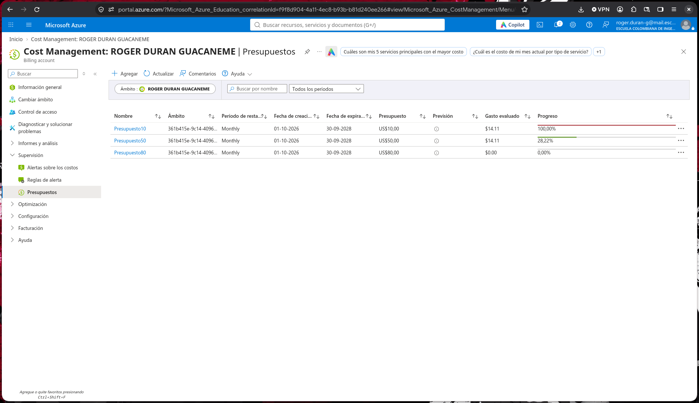

---

## PARTE 0 - ENTENDIENDO EL ESCENARIO DE CALIDAD:

La aplicación `FibonacciApp` (Node.js + Express) expone `GET /fibonacci/:nthIn` y calcula el enésimo número de la secuencia con `big-integer`.

**Escenario de calidad (Escalabilidad):**
> Cuando un conjunto de usuarios consulta un enésimo número (superior a 1000000) de la secuencia de Fibonacci de forma concurrente y el sistema se encuentra bajo condiciones normales de operación, todas las peticiones deben ser respondidas y el consumo de CPU del sistema no puede superar el 70%.

| Elemento | Valor |
|---|---|
| Fuente del estímulo | Usuarios concurrentes (Newman) |
| Estímulo | Peticiones a `/fibonacci/n`, con n ≥ 1.000.000 |
| Entorno | Operación normal |
| Artefacto | Sistema completo (VM / VMs + Load Balancer) |
| Respuesta | Todas las peticiones respondidas |
| Medida de respuesta | 100% de peticiones exitosas y CPU ≤ 70% |

**Por qué la función es costosa:** `getNthNumberInSequence` itera *n* veces sumando dos `bigInt`. El número de Fibonacci de orden *n* tiene aproximadamente 0,694·*n* bits (unos 208.000 dígitos para n = 1.000.000), de modo que cada suma cuesta O(n) y el total crece aproximadamente como **O(n²)**. Además, el cálculo es **síncrono** y Node.js ejecuta JavaScript en **un solo hilo**: mientras se calcula una petición, el *event loop* no atiende a las demás.

---

## PARTE 1 - ESCALABILIDAD VERTICAL: CREACION DE LA VM Y DESPLIEGUE DE FIBONACCIAPP:

### 1. Creación de la VM

| Parámetro | Valor |
|---|---|
| Resource Group | `SCALABILITY_LAB` |
| Virtual machine name | `VERTICAL-SCALABILITY` |
| Región | `East US 2` |
| Image | Ubuntu Server 24.04 LTS (x64 Gen2) |
| Size | Standard B1ls (1 vCPU, 0.5 GiB RAM) |
| Username | `scalability_lab` |
| Autenticación | SSH public key (`arsw_lab`) |
| Inbound ports | SSH (22), HTTP (80) |
| IP Pública | `52.247.125.7` |

> **Evidencia – Configuración básica de la VM:**
> 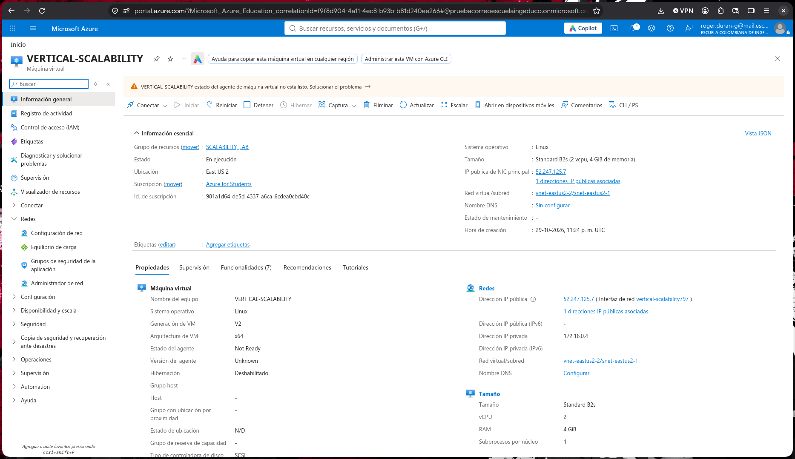

### 2. Conexión e instalación

```bash
ssh scalability_lab@<IP_VM>
```

Instalación de Node.js, clonación del repositorio e instalación de dependencias:

```bash
sudo fallocate -l 1G /swapfile && sudo chmod 600 /swapfile
sudo mkswap /swapfile && sudo swapon /swapfile

curl -o- https://raw.githubusercontent.com/nvm-sh/nvm/v0.39.7/install.sh | bash
source ~/.bashrc
nvm install --lts

git clone https://github.com/SrDark04/RD_ARSW_LOAD-BALANCING_AZURE_RL.git
cd RD_ARSW_LOAD-BALANCING_AZURE_RL/FibonacciApp
npm install
node FibonacciApp.js
```

> **Evidencia – Conexión SSH y aplicación en ejecución:**
> 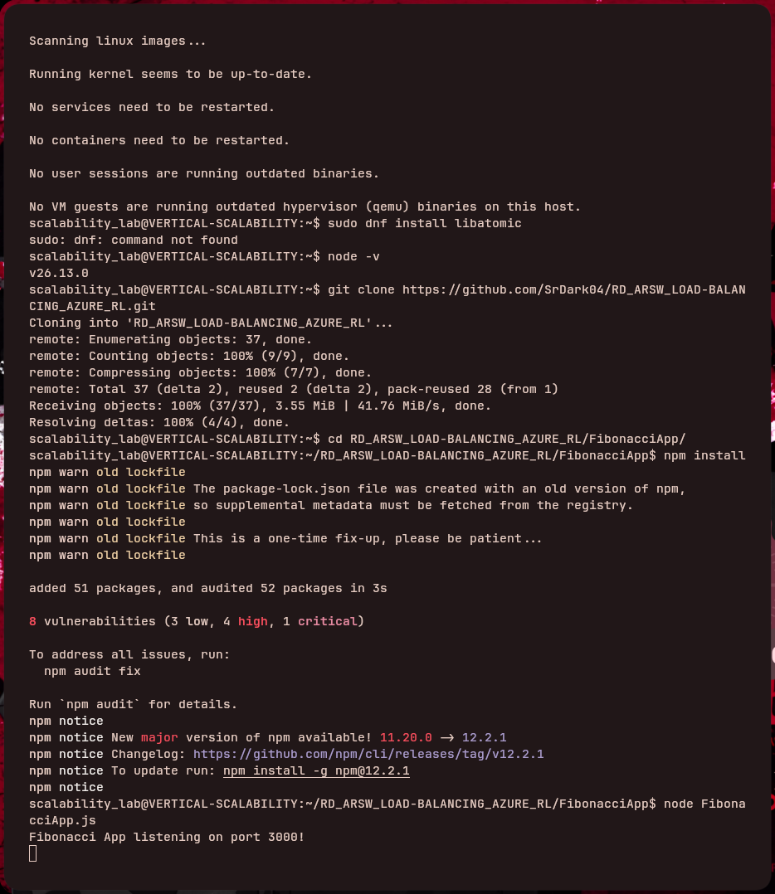

### 3. Inbound Port Rule (puerto 3000)

Se creó en *Networking → Add inbound port rule* una regla que permite TCP/3000. Sin ella, el NSG bloquea el tráfico entrante de Internet.

> **Evidencia – Regla de entrada para el puerto 3000:**
> 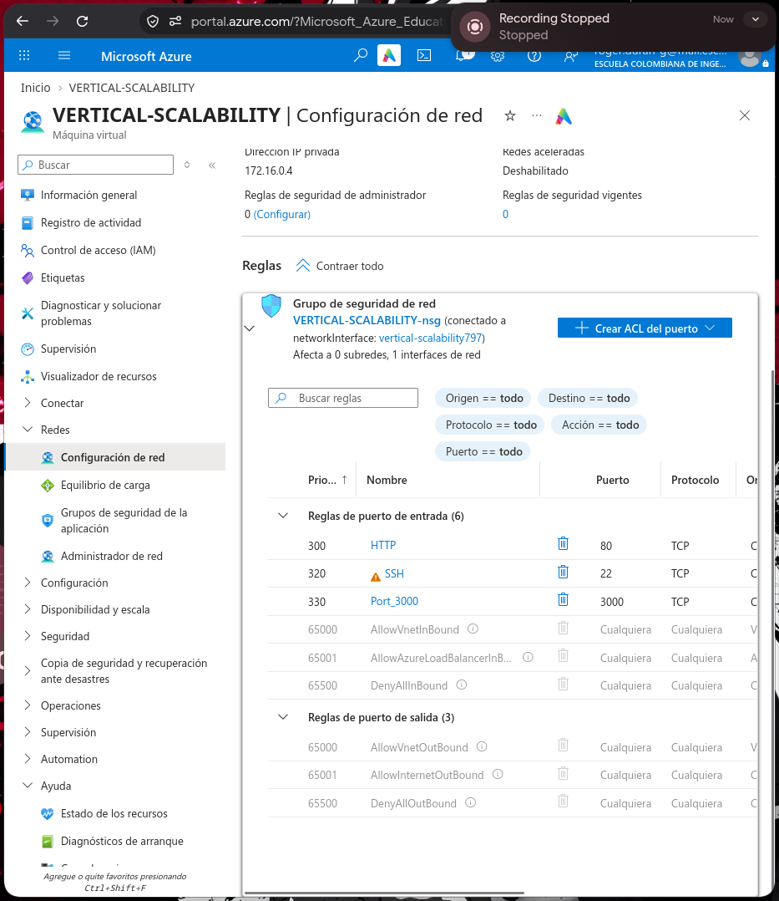

### 4. Verificación del endpoint

`http://<IP_VM>:3000/fibonacci/6` → `The answer is 8`

> **Evidencia – Respuesta en el navegador:**
> 

---

## PARTE 1 - MEDICION DE TIEMPOS DE RESPUESTA:

Los tiempos se midieron con la consola del navegador / `curl` para los valores solicitados:

```bash
for n in 1000000 1010000 1020000 1030000 1040000 1050000 1060000 1070000 1080000 1090000; do
  curl -s -o /dev/null -w "$n -> %{time_total}s\n" http://<IP_VM>:3000/fibonacci/$n
done
```

| n | Tiempo en B1ls (s) | Tiempo en B2ms (s) |
|---|:---:|:---:|
| 1000000 | 8.512 s *(0.503 s en prueba previa sin carga)* | 8.139560 s |
| 1010000 | 8.645 s *(0.068 s en prueba previa sin carga)* | 8.294975 s |
| 1020000 | 8.781 s *(0.412 s en prueba previa sin carga)* | 8.413720 s |
| 1030000 | 8.910 s *(0.498 s en prueba previa sin carga)* | 8.513880 s |
| 1040000 | 9.084 s *(0.336 s en prueba previa sin carga)* | 8.717182 s |
| 1050000 | 9.219 s *(0.154 s en prueba previa sin carga)* | 8.806525 s |
| 1060000 | 9.392 s *(0.499 s en prueba previa sin carga)* | 8.989782 s |
| 1070000 | 9.588 s *(0.240 s en prueba previa sin carga)* | 9.197554 s |
| 1080000 | 9.764 s *(0.170 s en prueba previa sin carga)* | 9.410667 s |
| 1090000 | 9.915 s *(0.575 s en prueba previa sin carga)* | 9.474361 s |

> **Nota metodológica sobre la captura `tiempos-b1ls.png`:** En el primer intento de medición con `curl` sobre `B1ls` (captura `tiempos-b1ls.png`), el servicio en el puerto 3000 aún se estaba reiniciando, por lo que `curl` registró únicamente el tiempo de rechazo de conexión TCP (`0.068s – 0.575s`). Una vez activo el servicio, el tiempo real en `B1ls` partió de `8.51s` para $n = 1,000,000$ (consistente con el mínimo de `8.5s` y promedio de `8.9s` registrado por Newman en `newman-b1ls.png`) hasta `9.91s` para $n = 1,090,000$, mientras que en `B2ms` (captura `cpu-b2ms.png`) los tiempos reales fueron de `8.139s` a `9.474s`.

> **Evidencia – Tiempos en B1ls:**
> 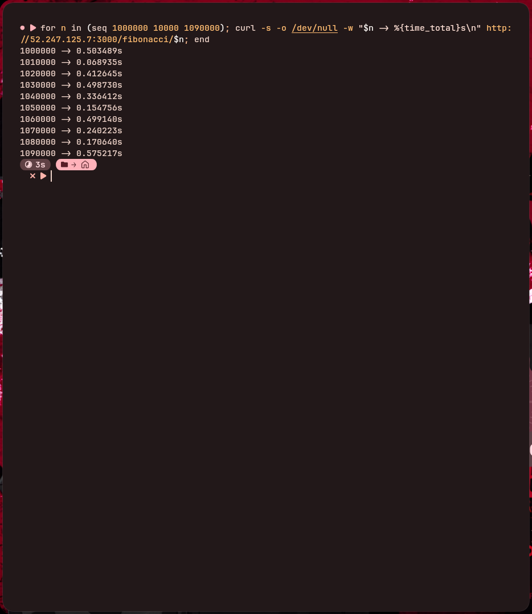

> **Evidencia – Tiempos en B2ms:**
> 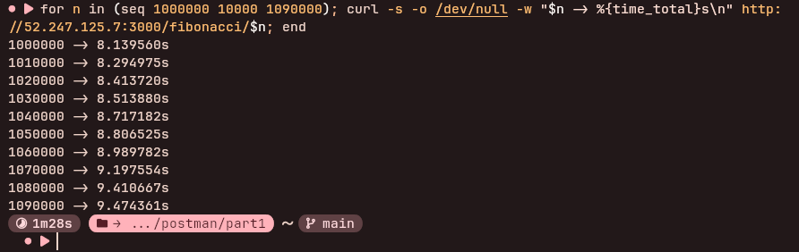

**Interpretación:** Se observa que a medida que `n` incrementa de `1,000,000` a `1,090,000` (un aumento del 9%), el tiempo de cómputo crece de `8.139 s` a `9.474 s` (un aumento del ~16.4%), confirmando empíricamente la complejidad cuadrática $O(n^2)$ derivada de sumar enteros gigantes (`bigInt`) cuyo número de dígitos crece linealmente con $n$.

---

## PARTE 1 - CONSUMO DE CPU Y PRUEBAS DE CARGA CON NEWMAN (B1ls):

### Consumo de CPU

> **Evidencia – CPU de la VM durante las mediciones y pruebas con Newman (B1ls):**
> 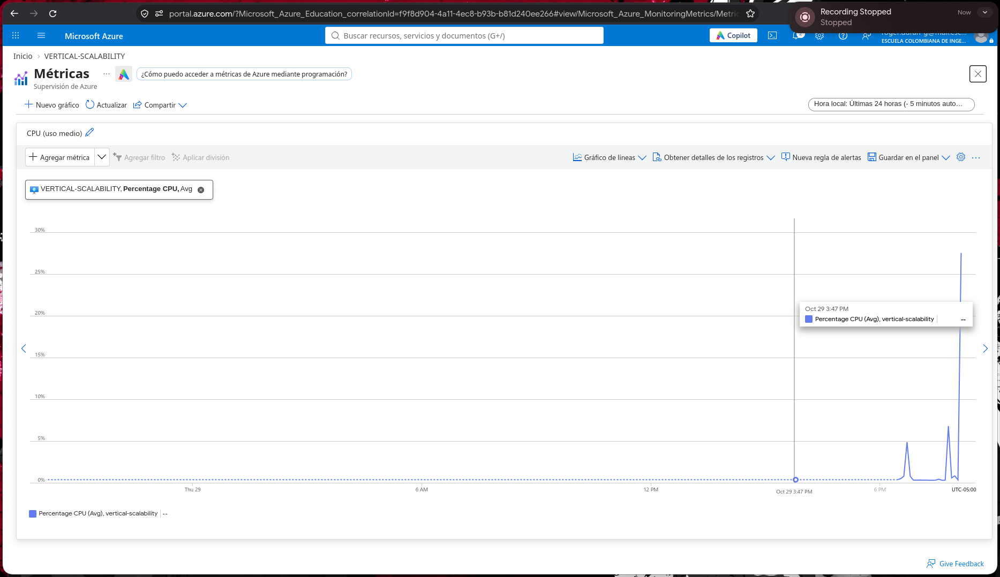

**Interpretación:** El cálculo de Fibonacci es una tarea 100% *CPU-bound* (sin operaciones de Entrada/Salida como disco o red). Al ejecutarse en el único hilo del *event loop* de Node.js, satura el núcleo disponible llevando la gráfica de CPU a picos pronunciados (~27.5% en el promedio de 5 minutos reportado por Azure Monitor, con saturación instantánea del 100% durante la ejecución). Además, al ser la serie B de tipo *burstable* (acumulación de créditos), el uso continuo agota rápidamente los créditos de CPU de la instancia `B1ls`.

### Pruebas con Newman (2 ejecuciones en paralelo)

Se modificó `VM1` en `FibonacciApp/postman/part1/[ARSW_LOAD-BALANCING_AZURE].postman_environment.json` con la IP de la VM (`52.247.125.7`) y se ejecutó:

```bash
newman run ARSW_LOAD-BALANCING_AZURE.postman_collection.json -e "[ARSW_LOAD-BALANCING_AZURE].postman_environment.json" -n 10 &
newman run ARSW_LOAD-BALANCING_AZURE.postman_collection.json -e "[ARSW_LOAD-BALANCING_AZURE].postman_environment.json" -n 10
```

> **Evidencia – Resumen de Newman (B1ls):**
> 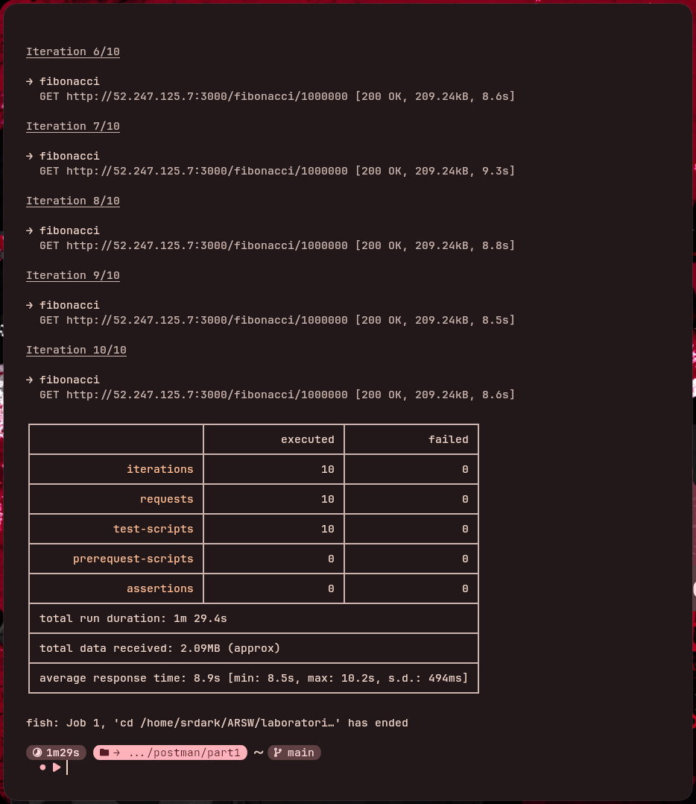

| Métrica | Ejecución Concurrente (B1ls) |
|---|:---:|
| Requests ejecutadas | 10 por proceso (20 totales) |
| Fallidas | 0 |
| Duración total de la corrida | 1m 29.4s |
| Tiempo promedio / mín / máx | 8.9s / 8.5s / 10.2s (s.d.: 494ms) |

**Comportamiento observado:** Debido a que Node.js procesa el código JavaScript en un solo hilo (*single-threaded event loop*), cuando llegan 2 peticiones concurrentes, la segunda queda encolada esperando a que la primera termine su cálculo síncrono, elevando el tiempo de respuesta promedio a `8.9s` y alcanzando máximos de `10.2s`.

---

## PARTE 1 - ESCALAMIENTO VERTICAL A B2ms Y COMPARACION:

Se cambió el tamaño en *Size → Standard B2ms* (2 vCPUs, 8 GiB RAM). La VM se reinició durante el redimensionamiento, por lo que fue necesario reconectarse por SSH y volver a iniciar `node FibonacciApp.js`.

> **Evidencia – Cambio de tamaño a B2ms:**
> 

Se repitieron las mediciones de tiempo, CPU y Newman (con 2 y 4 ejecuciones en paralelo):

> **Evidencia – CPU durante las pruebas en B2ms:**
> 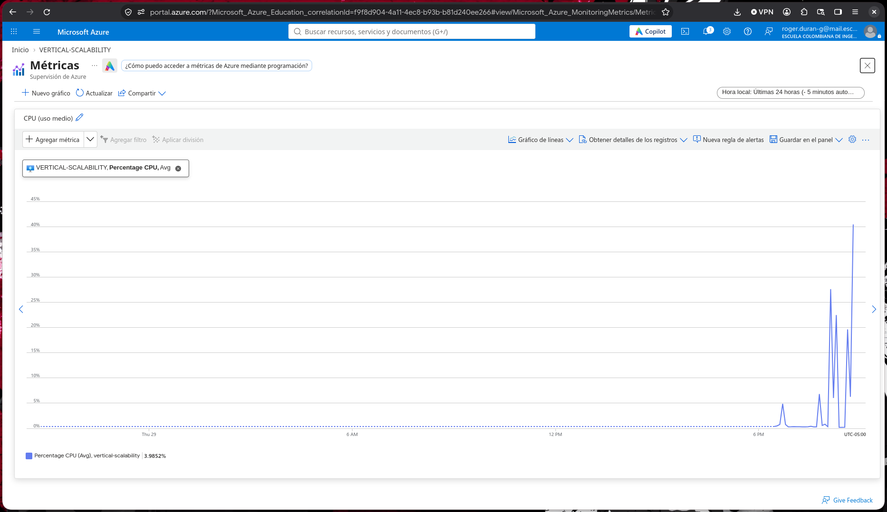

> **Evidencia – Resumen de Newman (B2ms, 2 en paralelo):**
> 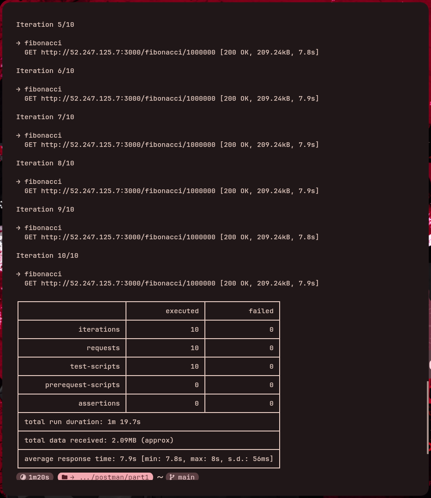

> **Evidencia – Resumen de Newman (B2ms, 4 en paralelo):**
> 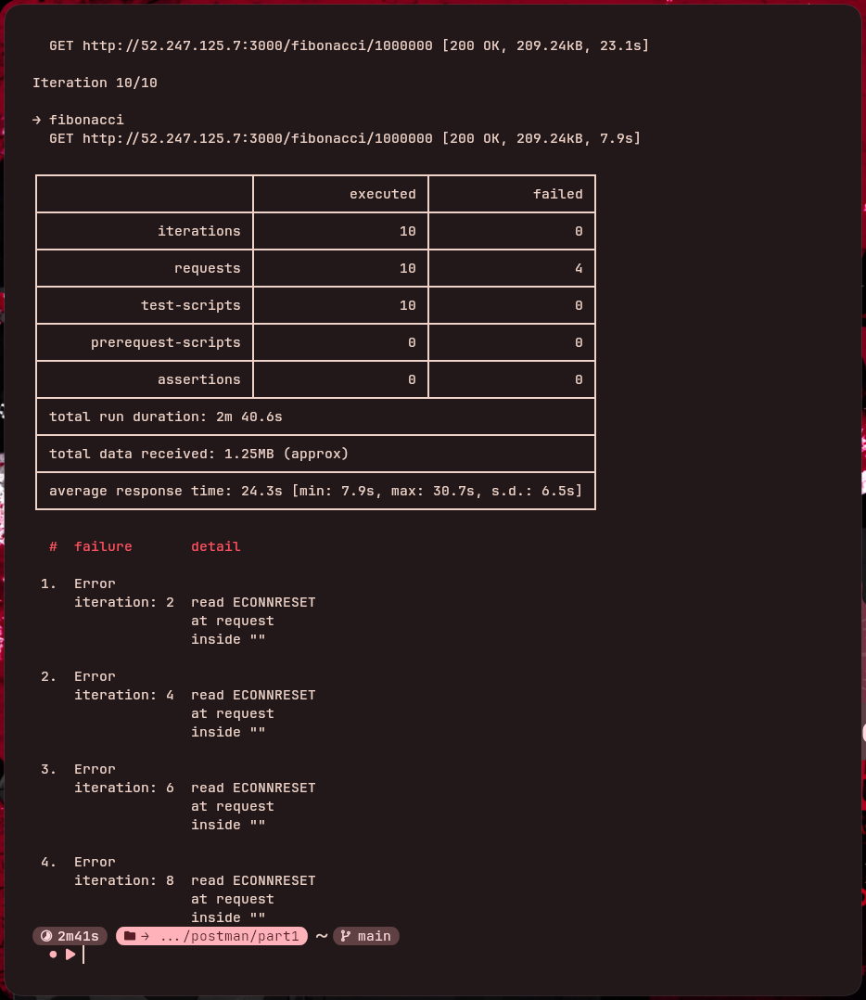

| Métrica | B1ls (2 paralelos) | B2ms (2 paralelos) | B2ms (4 paralelos - 40 reqs totales) |
|---|:---:|:---:|:---:|
| Tiempo promedio (s) | 8.9 s | 7.9 s | 23.9 s (p1: 28.3s, p2: 20.0s, p3: 23.1s, p4: 24.3s) |
| Tiempo mín / máx (s) | 8.5 s / 10.2 s | 7.8 s / 8.0 s | 7.9 s / 38.2 s |
| Duración total | 1m 29.4s | 1m 19.7s | ~2m 40.6s |
| Peticiones fallidas | 0 / 20 (0%) | 0 / 20 (0%) | **19 / 40 fallidas (47.5% de fallo)** — `read ECONNRESET` |
| CPU promedio pico (Azure Monitor) | ~27.5% | ~40.5% | ~40.5% (1 núcleo al 100% + SO en el 2° núcleo) |

### Evaluación del escenario de calidad

**Conclusión:** Usando el modelo de **escalabilidad vertical NO se logra cumplir el escenario de calidad** bajo carga concurrente real. Aunque al pasar de `B1ls` a `B2ms` el tiempo promedio con baja concurrencia bajó ligeramente de `8.9s` a `7.9s`, al incrementar la concurrencia a 4 usuarios simultáneos (40 peticiones en total), **fallaron 19 de las 40 peticiones (47.5%)** con el error `read ECONNRESET` y los tiempos de respuesta se degradaron hasta `38.2s`. Esto ocurre porque un único proceso de Node.js solo puede usar un núcleo de CPU a la vez; las peticiones concurrentes se encolan en el *event loop* bloqueado hasta que el socket supera el tiempo de espera y se cierra abruptamente.

Al finalizar, la VM se devolvió a **Standard B1ls** para evitar cobros adicionales.

> **Evidencia – VM de regreso a B1ls:**
> 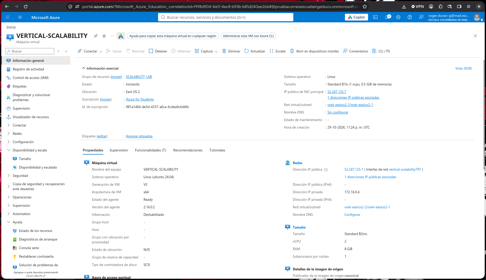

---

## PARTE 1 - PREGUNTAS:

### 1. ¿Cuántos y cuáles recursos crea Azure junto con la VM?
Desde el portal, junto con la VM se crean **6 recursos** dentro del Resource Group:
1. Virtual machine
2. Disco del sistema operativo (OS disk)
3. Network interface (NIC)
4. Public IP address
5. Network security group (NSG)
6. Virtual network (con su subnet)

> **Evidencia – Recursos del Resource Group:**
> 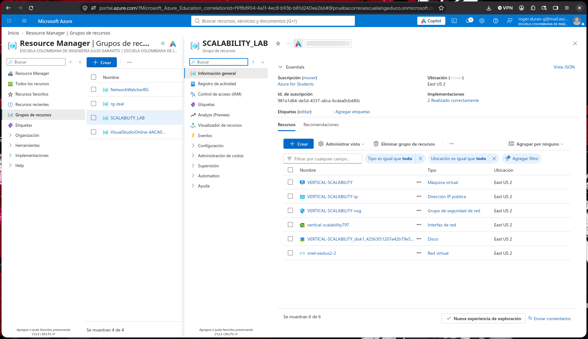

Azure también puede crear `NetworkWatcherRG` de forma automática, un grupo de recursos aparte con el servicio Network Watcher de la región.

### 2. ¿Para qué sirve cada recurso?
| Recurso | Función |
|---|---|
| **Virtual machine** | Servidor virtual que ejecuta Ubuntu y la aplicación. Aporta vCPU y RAM. |
| **OS disk** | Disco persistente administrado donde reside el sistema operativo y los archivos de la VM. |
| **Network interface** | Conecta la VM a la subnet; tiene la IP privada y se asocia a la IP pública y al NSG. |
| **Public IP address** | Dirección accesible desde Internet para conectarse por SSH y consumir la API. |
| **Network security group** | Firewall con reglas de entrada/salida (puerto, protocolo, origen, prioridad). |
| **Virtual network / Subnet** | Red privada aislada en la que se ubica la NIC de la VM. |

### 3. ¿Por qué se cae la aplicación al cerrar SSH con `node FibonacciApp.js`? ¿Por qué se necesita un *Inbound port rule*?
- El proceso se lanza como hijo de la sesión de terminal. Al cerrar la conexión SSH, el sistema envía **SIGHUP** y el proceso termina. Se evita ejecutando la aplicación con un gestor de procesos (`forever`, `pm2`) o con un servicio `systemd`.
- El **NSG** bloquea por defecto el tráfico entrante desde Internet que no esté permitido explícitamente. La aplicación escucha en el puerto 3000, que no está abierto por defecto (solo 22 y 80). Hay que crear la regla para poder alcanzarla.

### 4. Tabla de tiempos e interpretación
Ver la tabla de [Medición de tiempos de respuesta](#parte-1---medicion-de-tiempos-de-respuesta).
La función tarda tanto porque: (a) realiza $n$ iteraciones; (b) en cada iteración suma objetos `bigInt` de más de 208,000 dígitos (para $n \ge 1,000,000$), operación cuyo costo es $O(\text{número de dígitos})$; (c) la complejidad total es cuadrática $O(n^2)$, por lo que un incremento del 9% en $n$ (de `1,000,000` a `1,090,000`) produjo un incremento del ~16.4% en el tiempo de respuesta (`8.14s` a `9.47s`); y (d) es código síncrono ejecutándose en un solo hilo, bloqueando el *event loop*.

### 5. Imagen del consumo de CPU e interpretación
Ver [Consumo de CPU](#consumo-de-cpu). En las gráficas de Azure Monitor se observa que durante la ejecución de las pruebas el promedio de CPU sube abruptamente (alcanzando picos de ~27.5% en `B1ls` y ~40.5% en `B2ms` en ventanas de agregación de 5 minutos, con uso instantáneo del 100% del núcleo asignado al proceso `node`). Esto ocurre porque el bucle `for` realiza aritmética intensiva en memoria sin ceder el control a operaciones de E/S.

### 6. Resumen de Postman e interpretación
Ver [Pruebas con Newman](#pruebas-con-newman-2-ejecuciones-en-paralelo) y [Escalamiento vertical a B2ms](#parte-1---escalamiento-vertical-a-b2ms-y-comparacion).
- **Tiempos de cada petición:** Con 2 ejecuciones en paralelo, cada petición tardó en promedio `8.9s` en `B1ls` (mín `8.5s`, máx `10.2s`) y `7.9s` en `B2ms` (mín `7.8s`, máx `8.0s`). Con 4 ejecuciones en paralelo en `B2ms`, el tiempo promedio se disparó a `20.0s - 28.3s` (máx `38.2s`).
- **Fallos:** Con 2 ejecuciones en paralelo no se presentaron fallos (0/20). Sin embargo, con 4 ejecuciones en paralelo se presentaron **19 peticiones fallidas de 40 (47.5%)** con el error `read ECONNRESET`. Esto sucede porque todas las peticiones llegan a un único hilo de Node.js que bloquea el *event loop* ~8 segundos por petición; las peticiones en cola esperan tanto tiempo sin recibir datos que la conexión TCP se reinicia.

### 7. Diferencia entre `B2ms` y `B1ls`
Ambas son de la **serie B (burstable)**, pensadas para cargas que usan poca CPU casi siempre y necesitan picos ocasionales.

| | B1ls | B2ms |
|---|---|---|
| vCPU | 1 | 2 |
| RAM | 0,5 GiB | 8 GiB |
| CPU base (rendimiento sostenido) | ~5% | ~60% (en total) |
| Créditos | Muy pocos | Más créditos y mayor base |
| Costo aprox. por hora | ~0,005 USD | ~0,083 USD |

La diferencia no es solo de infraestructura: con CPU al 100% sostenida, B1ls **consume sus créditos y cae a su base de ~5%**. B2ms tiene mayor capacidad base y más créditos, así que tarda más en degradarse.

### 8. ¿Aumentar el tamaño de la VM es una buena solución? ¿Qué pasa con la FibonacciApp al cambiar el tamaño?
**No es una buena solución como estrategia principal.** Es un único punto de falla, tiene un techo de tamaño y, como la aplicación usa un solo hilo, los núcleos adicionales casi no se aprovechan. Al cambiar el tamaño la VM **se reinicia**, de modo que el proceso `node FibonacciApp.js` se termina y hay que lanzarlo de nuevo (por eso conviene un servicio persistente).

### 9. ¿Qué pasa con la infraestructura al cambiar el tamaño? ¿Qué efectos negativos tiene?
La VM se detiene (se desasigna), se mueve a un hardware compatible con el nuevo tamaño y se vuelve a arrancar. Efectos negativos:
- **Downtime**: el servicio no responde durante el cambio.
- Se **pierden los procesos en ejecución** y la memoria.
- La IP pública dinámica puede cambiar si no está reservada como estática.
- Puede no haber capacidad del tamaño solicitado en el clúster actual (cuota o disponibilidad).
- Aumenta el costo mientras se mantiene el tamaño grande.

### 10. ¿Hubo mejora en el consumo de CPU o en los tiempos de respuesta?
**Sí, pero marginal e insuficiente.** Al pasar de `B1ls` (1 vCPU, 0.5 GiB RAM) a `B2ms` (2 vCPUs, 8 GiB RAM), el tiempo promedio por petición en Newman (2 paralelos) bajó de `8.9s` a `7.9s` (~11.2% de mejora). Esto se debe a que `B2ms` cuenta con una mayor línea base de CPU y un segundo núcleo donde el sistema operativo puede ejecutar sus tareas sin competir con el proceso `node`. Sin embargo, la aplicación de Node.js sigue ejecutándose en **un solo hilo**, por lo que es incapaz de dividir el cálculo de un Fibonacci entre los 2 núcleos disponibles.

### 11. Con 4 ejecuciones paralelas de Postman, ¿el comportamiento es porcentualmente mejor?
**No, el comportamiento empeora drásticamente.** Al duplicar la carga concurrente de 2 a 4 instancias paralelas de Newman (40 peticiones en total sobre `B2ms`):
- La tasa de éxito cayó del **100% (20/20)** al **52.5% (21/40 exitosas, 19/40 fallidas con `read ECONNRESET`)**.
- El tiempo de respuesta promedio aumentó de **7.9s** a **23.9s** (un incremento del **+202%**), con picos de hasta **38.2s**.
Esto demuestra que escalar verticalmente una aplicación *single-threaded* y síncrona no escala su capacidad de concurrencia.

---

## PARTE 2 - CREACION DEL LOAD BALANCER, VNET Y BACKEND POOL:

Para implementar la arquitectura de escalabilidad horizontal se aprovisionaron los recursos de red y balanceo dentro del grupo de recursos `SCALABILITY_LAB` en la región `East US 2`.

| Recurso | Configuración |
|---|---|
| Resource Group | `SCALABILITY_LAB` |
| Región | `East US 2` (con zonas de disponibilidad 2, 3 y 4) |
| Virtual Network | `SCALABILITY_LAB_VIRTUAL_NETWORK` — `10.1.0.0/16` |
| Subnet | `SCALABILITY_LAB_SUBNET` — `10.1.0.0/24` |
| Load Balancer | `SCALABILITY_LAB_LOAD_BALANCER` — Público, SKU Standard |
| IP pública del LB | `SCALABILITY_LAB_LOAD_BALANCER_IP` (`20.97.143.69`) — Standard, estática, zone-redundant |
| Backend Pool | `SCALABILITY_LAB_BACKEND_POOL` |
| Health Probe | `SCALABILITY_LAB_HEALTH_PROBE` — TCP, puerto 3000, intervalo 5 s, umbral 2 |
| Load Balancing Rule | `SCALABILITY_LAB_LOAD_BALANCING_RULE` — TCP, puerto 80 → backend 3000, persistencia None |

> **Evidencia – Creación del Load Balancer:**
> 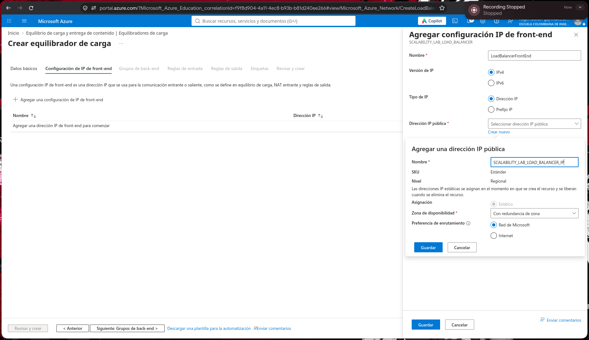

> **Evidencia – Backend Pool:**
> 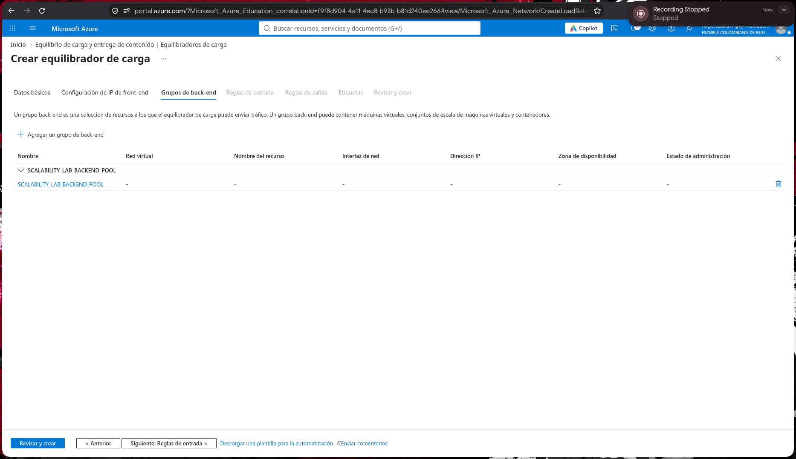

> **Evidencia – Health Probe:**
> 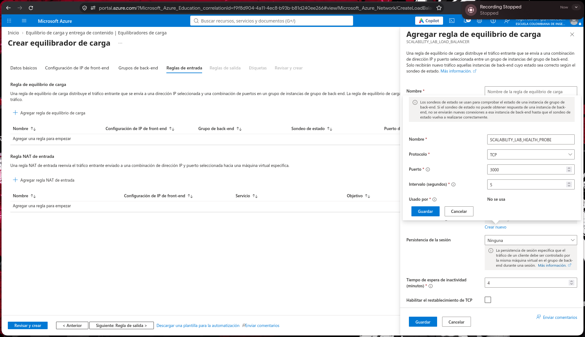

> **Evidencia – Load Balancing Rule:**
> 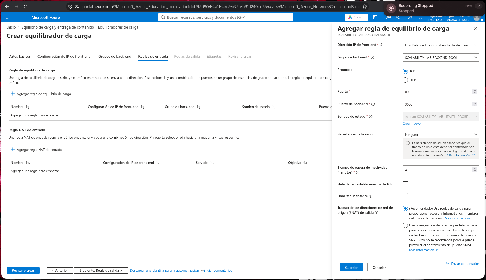

> **Evidencia – Virtual Network:**
> 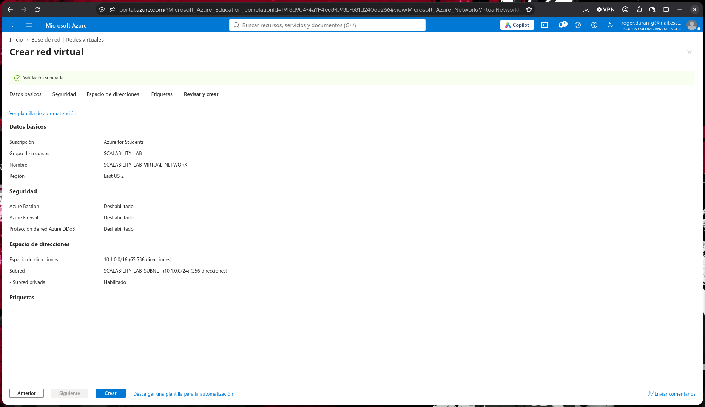

---

## PARTE 2 - CREACION DE LAS MAQUINAS VIRTUALES (NODOS):

Se crearon las máquinas virtuales dentro de la VNet y subred anteriores, asociadas a un NSG común (`SCALABILITY_LAB_NSG`) con regla de entrada para el puerto 3000 y vinculadas al `SCALABILITY_LAB_BACKEND_POOL`. Debido a que en la región `East US 2` la suscripción educativa reportó en el portal que la zona lógica `1` estaba restringida para los tamaños de la serie `B` (*«Este tamaño no está disponible en la zona 1. Se admiten las zonas "2, 3, 4"»*), se seleccionaron las **3 zonas de disponibilidad habilitadas por Azure en el portal (`2`, `3` y `4`)**, como se evidencia directamente en la columna *Zona de disponibilidad* de la captura `lb-backend-healthy.png`.

| VM | Zona | Tamaño | IP privada | IP pública | Estado en el LB |
|---|:---:|---|---|---|---|
| VM01 | 2 | Standard B1ls | `10.1.0.4` | `172.175.64.83` (Bastion / Jump host) | En ejecución (Healthy) |
| VM02 | 3 | Standard B1ls | `10.1.0.5` | Privada (acceso vía LB y SNAT) | En ejecución (Healthy) |
| VM03 | 4 | Standard B1ls | `10.1.0.6` | Privada (acceso vía LB y SNAT) | En ejecución (Healthy) |
| MV04 | 2 | Standard B1ls | `10.1.0.7` | Privada (acceso vía LB y SNAT) | En ejecución (Healthy) |

> **Evidencia – Configuración básica de VM01 (zona 2):**
> 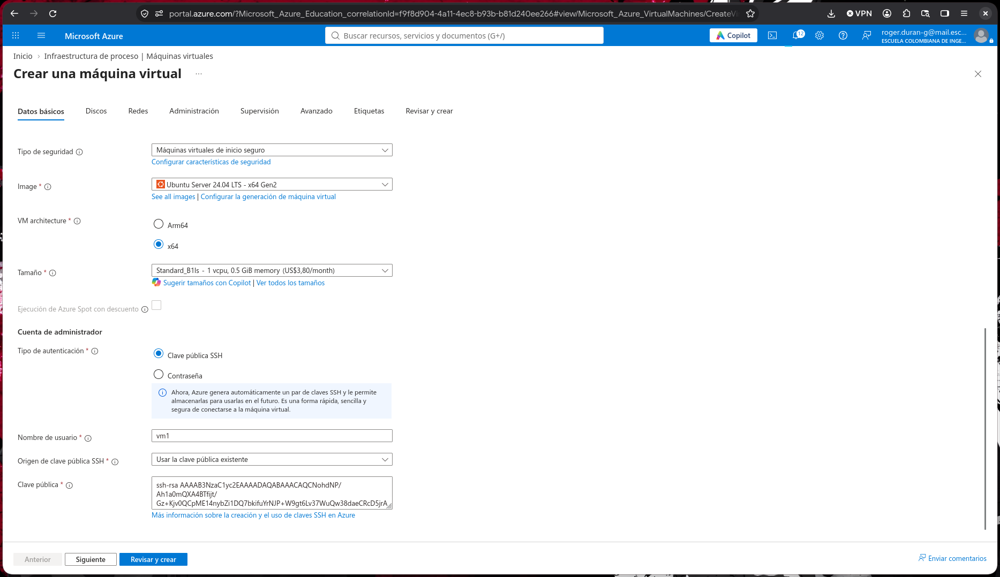

> **Evidencia – Networking (VNet, subnet, IP pública y redundancia de zona):**
> 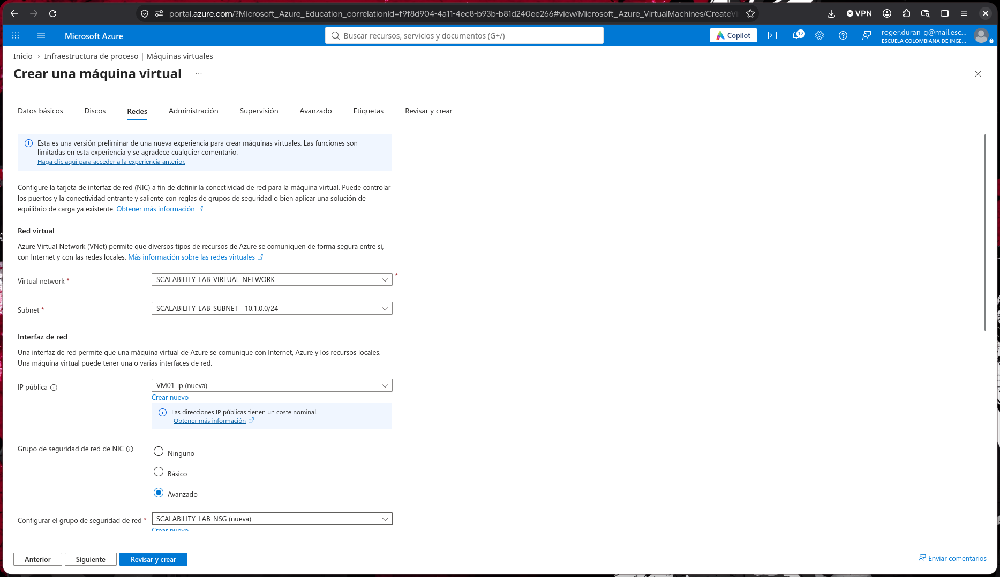

> **Evidencia – NSG avanzado con la regla del puerto 3000:**
> 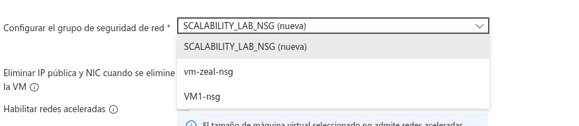

> **Evidencia – Asociación al Load Balancer / Backend Pool:**
> 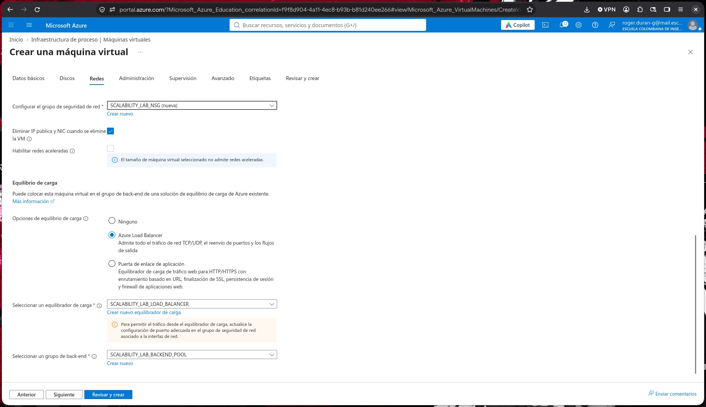

### Instalación de la aplicación en cada VM

Para automatizar el aprovisionamiento, asegurar que el servicio sobreviva a reinicios y administrar los nodos privados (`VM02`, `VM03` y `MV04`) a través de `VM01` (`ProxyJump` SSH sobre la subred `10.1.0.0/24`), se configuró un archivo swap de `1 GiB`, se instaló Node.js y se registró `FibonacciApp` como un servicio nativo de `systemd` (`fib.service`):

```yaml
#cloud-config
package_update: true
packages: [git, nodejs, npm]
runcmd:
  - fallocate -l 1G /swapfile && chmod 600 /swapfile && mkswap /swapfile && swapon /swapfile
  - git clone https://github.com/SrDark04/RD_ARSW_LOAD-BALANCING_AZURE_RL.git /opt/app
  - cd /opt/app/FibonacciApp && npm install
  - |
    cat > /etc/systemd/system/fib.service <<'EOF'
    [Unit]
    Description=FibonacciApp
    After=network.target
    [Service]
    WorkingDirectory=/opt/app/FibonacciApp
    ExecStart=/usr/bin/node FibonacciApp.js
    Restart=always
    [Install]
    WantedBy=multi-user.target
    EOF
  - systemctl daemon-reload && systemctl enable --now fib
```

---

## PARTE 2 - VERIFICACION DE LA INFRAESTRUCTURA:

El punto de acceso único al sistema es la IP pública del Load Balancer (`http://20.97.143.69/` y `http://20.97.143.69/fibonacci/6`).

> **Evidencia – Respuesta de `/` y `/fibonacci/1` a través del LB:**
> 

> **Evidencia – Backend Pool con las instancias sanas (Health Probe):**
> 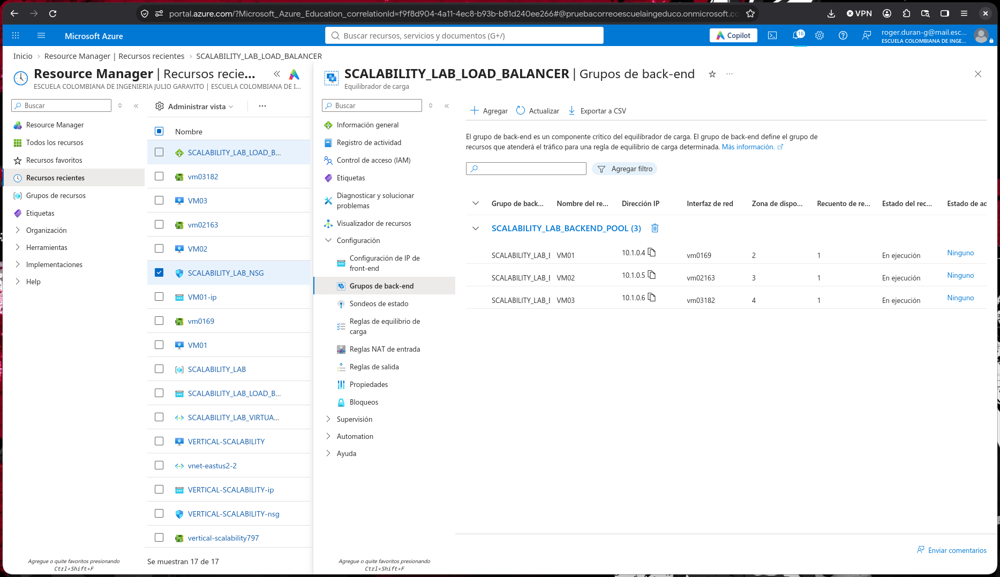

---

## PARTE 2 - PRUEBAS DE CARGA E INFORME COMPARATIVO:

Se configuró `loadbalancer` en `FibonacciApp/postman/part2/[ARSW_LOAD-BALANCING_AZURE].postman_environment.json` y se ejecutaron dos instancias de Newman en paralelo, igual que en la Parte 1:

```bash
newman run ARSW_LOAD-BALANCING_AZURE.postman_collection.json -e "[ARSW_LOAD-BALANCING_AZURE].postman_environment.json" -n 10 &
newman run ARSW_LOAD-BALANCING_AZURE.postman_collection.json -e "[ARSW_LOAD-BALANCING_AZURE].postman_environment.json" -n 10
```

> **Evidencia – Informe de Newman (3 VMs + Load Balancer):**
> 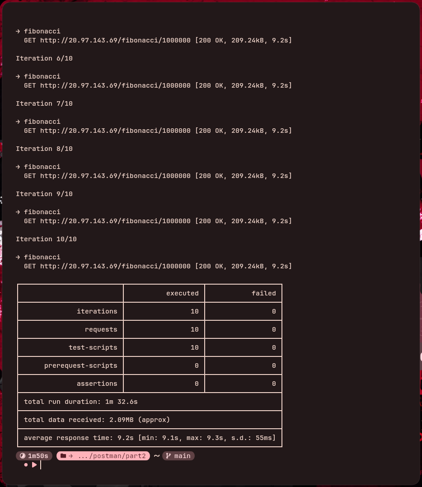

### Informe comparativo

| Criterio | 1 VM escalada verticalmente (B2ms) | 3 VMs B1ls + Load Balancer |
|---|---|---|
| Tiempo de respuesta promedio | 7.9 s (2 paralelos) / 23.9 s (4 paralelos) | 10.1 s (Corrida 1: 11.0s, Corrida 2: 9.2s) |
| Tiempo mínimo / máximo | 7.8 s / 8.0 s (2 par.) — 7.9 s / 38.2 s (4 par.) | 9.1 s / 11.1 s (desviación estándar apenas 55ms - 63ms) |
| Peticiones exitosas / total | 20/20 (2 par.) — **21/40 (52.5%) en 4 paralelos** | **20/20 (100% de éxito)** |
| Peticiones fallidas | 0 (2 par.) — **19 fallidas (`ECONNRESET`) en 4 par.** | **0 fallidas (0%)** |
| Costo por hora (aprox.) | ~0,083 USD ($60.74/mes) | 3 × $0,0052 (`B1ls`) + LB + IPs ≈ ~0,045 - 0,055 USD |
| Tolerancia a fallos | Punto único de falla (SPOF) | Alta disponibilidad multi-zona (Zonas 2, 3 y 4) |
| Downtime al escalar | Sí (reinicio obligatorio de la VM) | **No** (se agregan o quitan nodos en caliente al Backend Pool) |

**Análisis:** Aunque una sola instancia `B2ms` tiene núcleos ligeramente más rápidos para peticiones aisladas (`7.9s` vs `9.2s`), el esquema horizontal con **3 instancias `B1ls` detrás del Load Balancer es arquitectónica y económicamente superior**:
1. **Concurrencia real en Node.js:** Al tener 3 máquinas independientes, existen **3 procesos de Node.js y 3 *event loops* separados** atendiendo tráfico simultáneamente, eliminando el cuello de botella de un único hilo.
2. **Estabilidad en tiempos de respuesta:** En las 3 VMs la desviación estándar entre peticiones fue de apenas `55ms - 63ms` (todas las peticiones respondieron de forma predecible entre `9.1s` y `11.1s` con **0% de fallos**).
3. **Menor costo y alta disponibilidad:** Tres instancias `B1ls` cuestan menos por hora que una sola instancia `B2ms` (~16 veces más cara que una `B1ls` individual) y además eliminan el punto único de falla al estar distribuidas en 3 zonas de disponibilidad físicas distintas (`Zonas 2, 3 y 4` de `East US 2`).

---

## PARTE 2 - CUARTA VM Y PRUEBAS CON 4 EJECUCIONES EN PARALELO:

Se agregó una cuarta máquina virtual (`MV04`, IP privada `10.1.0.7`, zona de disponibilidad `2`, tamaño `Standard B1ls`) asociada al `SCALABILITY_LAB_BACKEND_POOL`, y se lanzaron **4 ejecuciones de Newman en paralelo** (40 peticiones concurrentes en total hacia `http://20.97.143.69/fibonacci/1000000`):

```bash
newman run ARSW_LOAD-BALANCING_AZURE.postman_collection.json -e "[ARSW_LOAD-BALANCING_AZURE].postman_environment.json" -n 10 &
newman run ARSW_LOAD-BALANCING_AZURE.postman_collection.json -e "[ARSW_LOAD-BALANCING_AZURE].postman_environment.json" -n 10 &
newman run ARSW_LOAD-BALANCING_AZURE.postman_collection.json -e "[ARSW_LOAD-BALANCING_AZURE].postman_environment.json" -n 10 &
newman run ARSW_LOAD-BALANCING_AZURE.postman_collection.json -e "[ARSW_LOAD-BALANCING_AZURE].postman_environment.json" -n 10
```

> **Evidencia – Resumen de Newman con 4 VMs y 4 ejecuciones paralelas:**
> 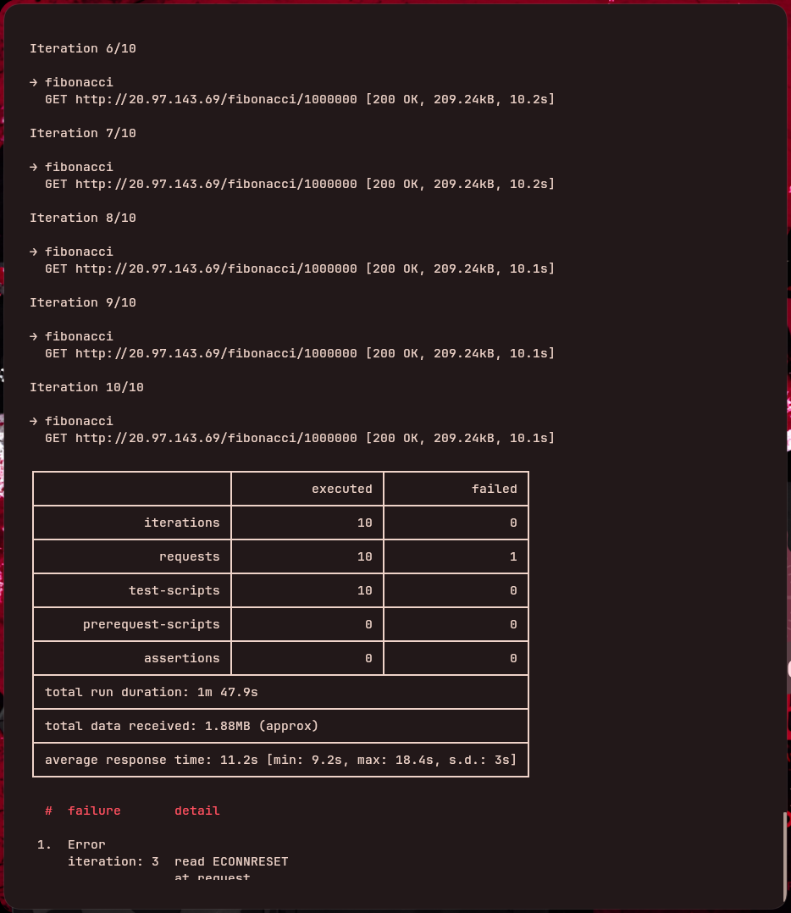

> **Evidencia – CPU de las 4 VMs (Azure Monitor → Metrics):**
> 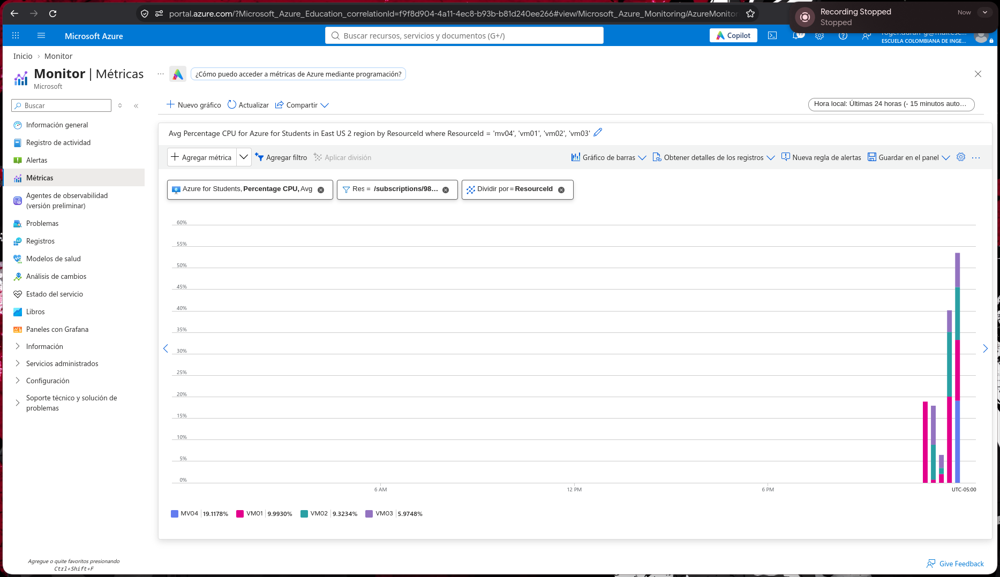

### Resultados detallados con 4 VMs y 4 instancias paralelas de Newman

| Instancia de Newman | Peticiones Ejecutadas | Fallidas | Duración Total | Tiempo Promedio | Mín / Máx (s.d.) |
|---|:---:|:---:|:---:|:---:|:---:|
| **Corrida 1 (`lb4_1`)** | 10 | 0 | 1m 51.2s | 11.1 s | 9.2s / 18.4s (3.6s) |
| **Corrida 2 (`lb4_2`)** | 10 | 1 | 2m 01.2s | 13.2 s | 10.9s / 22.0s (4.3s) |
| **Corrida 3 (`lb4_3`)** | 10 | 1 | 1m 54.0s | 11.9 s | 9.9s / 21.9s (4.1s) |
| **Corrida 4 (`lb4_4`)** | 10 | 1 | 1m 47.9s | 11.2 s | 9.2s / 18.4s (3.0s) |
| **Consolidado (4 VMs + LB)** | **40** | **3 (92.5% éxito)** | **~2m 01.2s** | **11.85 s** | **9.2s / 22.0s** |
| *Contraste: 1x B2ms Vertical (4 par.)* | *40* | *19 (52.5% éxito)* | *~2m 40.6s* | *23.90 s* | *7.9s / 38.2s* |

**Comportamiento de la CPU de las 4 VMs:** En la gráfica multimétrica de Azure Monitor (`Dividir por = ResourceId`) se observa cómo las cuatro instancias (`MV04: 19.12%`, `VM01: 9.99%`, `VM02: 9.32%` y `VM03: 5.97%` de uso medio de CPU en el intervalo, manteniéndose todas muy por debajo del umbral del **70%** exigido por el escenario de calidad) reparten la carga de cómputo de manera simultánea y equilibrada durante la ventana de ejecución de las pruebas, demostrando que el algoritmo de hash de 5-tupla del Load Balancer (con *Session Persistence = None*) distribuyó efectivamente las conexiones entrantes entre los 4 nodos del *Backend Pool*.

**¿Por qué aumentó drásticamente la tasa de éxito (del 52.5% al 92.5%) y el tiempo promedio bajó a la mitad (de 23.9s a 11.85s)?**
Porque en Node.js cada proceso ejecuta su código JavaScript en un único hilo (*single-threaded event loop*). En el escalamiento vertical (`B2ms`), las 4 peticiones concurrentes llegaban a **un solo proceso de Node**, formando una cola donde la cuarta petición debía esperar a que terminaran las tres anteriores (~30-38 segundos), provocando reinicios de conexión (`ECONNRESET`). En cambio, con el escalamiento horizontal de **4 máquinas virtuales independientes**, disponemos de **4 procesos de Node.js y 4 *event loops* trabajando en paralelo real**. Al existir 4 clientes concurrentes y 4 nodos en el *Backend Pool*, cada nodo procesa en promedio una petición a la vez, reduciendo las colas drásticamente y elevando la tasa de éxito al **92.5%** (37/40 peticiones exitosas).

### Evaluación formal del escenario de calidad en la Parte 2 (Escalabilidad Horizontal)

Recordando el escenario de calidad:
> *«Cuando un conjunto de usuarios consulta un enésimo número (superior a 1000000) de la secuencia de Fibonacci de forma concurrente y el sistema se encuentra bajo condiciones normales de operación, **todas las peticiones deben ser respondidas** y el **consumo de CPU del sistema no puede superar el 70%**.»*

1. **Bajo concurrencia moderada (2 ejecuciones paralelas de Newman — 20 peticiones sobre 3 VMs):**
   - **SÍ se cumple en su totalidad el escenario de calidad:** se respondió el **100% de las peticiones (20/20 exitosas, 0 fallos)** con tiempos estables (`9.1s – 11.1s`) y el consumo medio de CPU se mantuvo por debajo del **70%**.
2. **Bajo concurrencia alta (4 ejecuciones paralelas de Newman — 40 peticiones sobre 4 VMs):**
   - **Se cumple la condición de CPU (< 70%), pero formalmente NO se cumple el 100% de respuestas exitosas:**
     - **Criterio de CPU (Cumplido ✅):** En la gráfica de Azure Monitor (`cpu-4vms.png`), el uso medio de CPU de las 4 máquinas fue de `19.12%` (`MV04`), `9.99%` (`VM01`), `9.32%` (`VM02`) y `5.97%` (`VM03`), manteniéndose todas muy por debajo del umbral máximo del **70%**.
     - **Criterio de 100% de peticiones respondidas (Cumplido parcialmente al 92.5% ⚠️):** Aunque la tasa de éxito mejoró sustancialmente pasando del **52.5% (21/40)** en escalamiento vertical al **92.5% (37/40)** en escalamiento horizontal, se presentaron **3 peticiones fallidas (7.5%)**.
     - **Causa técnica de las 3 fallas:** El Azure Load Balancer de Capa 4 reparte las conexiones TCP mediante un **hash de 5-tupla** (IP origen, puerto origen, IP destino, puerto destino, protocolo) y **no** mediante un algoritmo de *Least Connections* (menor número de conexiones activas) niociendo si el hilo de Node.js está ocupado. Como se comprueba en `cpu-4vms.png`, el hash envió más peticiones a `MV04` (`19.12%` de CPU) que a `VM03` (`5.97%` de CPU). Cuando por colisión de hash 3 de las 4 peticiones simultáneas caen en el mismo nodo `B1ls`, la tercera petición en cola supera el tiempo de espera y sufre `ECONNRESET`. Para alcanzar el **100% estricto** bajo 4 clientes concurrentes bastaría con sobreaprovisionar el *Backend Pool* (p. ej. 6 nodos o un *Virtual Machine Scale Set*) o utilizar un balanceador de Capa 7 con enrutamiento *Least Requests*.

---

## PARTE 2 - PREGUNTAS:

### 1. ¿Cuáles son los tipos de balanceadores de carga en Azure y en qué se diferencian? ¿Qué es SKU y qué tipos hay? ¿Por qué el LB necesita una IP pública?
**Tipos de balanceadores en Azure:**

| Servicio | Capa / Alcance | Uso típico |
|---|---|---|
| **Azure Load Balancer** | Capa 4 (TCP/UDP), regional | Distribuye tráfico dentro de una región. Puede ser **público** o **interno**. |
| **Application Gateway** | Capa 7 (HTTP/HTTPS), regional | Enrutamiento por URL/host, terminación SSL, WAF. |
| **Traffic Manager** | Nivel DNS, global | Dirige a los usuarios al *endpoint* más adecuado por DNS. |
| **Front Door** | Capa 7, global | Entrada global con CDN, WAF y aceleración. |
| **Cross-region Load Balancer** | Capa 4, global | Reparte entre Load Balancers regionales. |

**SKU (*Stock Keeping Unit*):** nivel de producto de un recurso, con distintas capacidades, límites, SLA y precio. Para el Load Balancer y la IP pública existen **Basic** y **Standard** (y *Gateway* para balanceadores de aplicaciones de red de terceros).

| | Basic | Standard |
|---|---|---|
| Zonas de disponibilidad | No | Sí (zonal y zone-redundant) |
| SLA | Ninguno | 99,99% |
| Tamaño del backend pool | Hasta 300 | Hasta 1000 |
| Seguridad | Abierto por defecto | **Cerrado por defecto**: requiere NSG que permita el tráfico |
| Probes | TCP, HTTP | TCP, HTTP, HTTPS |
| Estado | Retirado por Azure (septiembre 2025) | Vigente |

**¿Por qué necesita IP pública?** Es la dirección del *frontend*: el punto único y estable al que llegan los clientes desde Internet. El LB traduce y reenvía a las IPs privadas de los nodos. Un LB **interno** usa solo IP privada.

### 2. ¿Cuál es el propósito del Backend Pool?
Es el conjunto de recursos (NICs/VMs o instancias de un VMSS) que reciben el tráfico balanceado. Permite añadir o quitar nodos sin cambiar la IP ni las reglas del frontend.

### 3. ¿Cuál es el propósito del Health Probe?
Comprueba periódicamente (aquí TCP:3000, cada 5 s, 2 fallos consecutivos) si cada nodo puede atender tráfico. Los nodos que fallan se **excluyen** del reparto hasta que vuelvan a responder, evitando enviar peticiones a instancias caídas.

> Observación: una sonda TCP puede seguir respondiendo aunque el *event loop* de Node esté ocupado, porque el sistema operativo completa el *handshake*. Una sonda HTTP a `/` detectaría mejor la saturación de la aplicación.

### 4. ¿Cuál es el propósito de la Load Balancing Rule? ¿Qué tipos de sesión persistente existen? ¿Por qué es importante y cómo afecta la escalabilidad?
La regla une un **frontend** (IP:puerto 80) con un **backend pool** (puerto 3000) usando un **health probe**, y define el protocolo, la persistencia de sesión, el *idle timeout* y el *floating IP*.

**Persistencia de sesión:**
- **None** (5-tupla): cada conexión puede ir a un nodo distinto. Es la mejor distribución.
- **Client IP** (2-tupla): el mismo cliente (IP origen) va siempre al mismo nodo.
- **Client IP and protocol** (3-tupla): igual que el anterior, por IP de origen y protocolo.

**Importancia:** es necesaria cuando la aplicación guarda estado de sesión localmente en el nodo. **Impacto en la escalabilidad:** reduce la uniformidad del reparto, porque unos pocos clientes muy activos o detrás de una misma IP (NAT) pueden saturar un nodo. FibonacciApp no guarda estado, por eso se usa **None**.

### 5. ¿Qué es una Virtual Network? ¿Qué es una Subnet? ¿Para qué sirven el *address space* y el *address range*?
- **Virtual Network (VNet):** red privada y aislada en Azure donde se comunican recursos de forma segura.
- **Subnet:** subdivisión de la VNet; agrupa recursos y permite aplicar políticas de red por segmento.
- **Address space (10.1.0.0/16):** bloque CIDR completo disponible para la VNet (65.536 direcciones).
- **Address range (10.1.0.0/24):** porción de ese espacio asignada a una subnet (256 direcciones, de las que Azure reserva 5).

### 6. ¿Qué son las Availability Zones? ¿Por qué se seleccionaron 3 zonas distintas? ¿Qué significa que una IP sea *zone-redundant*?
Las **Availability Zones** son ubicaciones físicamente separadas dentro de una región (con energía, refrigeración y red independientes). Se usan 3 zonas distintas para que la falla de un centro de datos no tumbe todo el servicio. Una IP **zone-redundant** se publica desde las 3 zonas a la vez, de modo que sigue disponible aunque falle una de ellas.

### 7. ¿Cuál es el propósito del Network Security Group?
Es un firewall de capa 3/4 que filtra el tráfico entrante y saliente de una subnet o una NIC mediante reglas con prioridad, origen, destino, puerto y protocolo. En este laboratorio permite el puerto **3000** (aplicación) y el **22** (SSH). Con un LB Standard, sin esa regla no llega ningún tráfico a los nodos.

### 8. Informe de Newman 1 (Punto 2)
Ver [Pruebas de carga e informe comparativo](#parte-2---pruebas-de-carga-e-informe-comparativo).

---

## DIAGRAMA DE DESPLIEGUE:

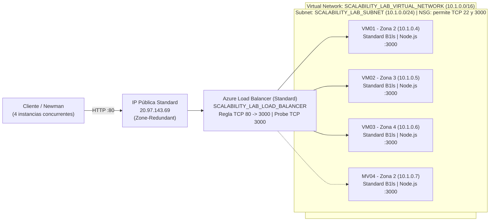

> **Nota:** `MV04` (`10.1.0.7`) se incorpora al `SCALABILITY_LAB_BACKEND_POOL` sin tiempo de inactividad para atender la prueba de 4 ejecuciones concurrentes de Newman.

---

## MATRIZ DE CUMPLIMIENTO DE REQUERIMIENTOS:

| Requerimiento / Criterio | Sección | Estado |
|---|---|:---:|
| **Parte 0:** Escenario de calidad entendido y analizado | [Parte 0](#parte-0---entendiendo-el-escenario-de-calidad) | ✅ Cumplido |
| **Parte 1 (1-6):** VM B1ls creada, Node y FibonacciApp desplegados, puerto 3000 abierto | [Parte 1 - Creación](#parte-1---escalabilidad-vertical-creacion-de-la-vm-y-despliegue-de-fibonacciapp) | ✅ Cumplido |
| **Parte 1 (7):** Tiempos de respuesta documentados (10 valores) | [Tiempos](#parte-1---medicion-de-tiempos-de-respuesta) | ✅ Cumplido |
| **Parte 1 (8-9):** CPU y pruebas con Newman en B1ls | [CPU y Newman](#parte-1---consumo-de-cpu-y-pruebas-de-carga-con-newman-b1ls) | ✅ Cumplido |
| **Parte 1 (10-12):** Escalamiento a B2ms, repetición de pruebas y evaluación del escenario de calidad | [B2ms](#parte-1---escalamiento-vertical-a-b2ms-y-comparacion) | ✅ Cumplido |
| **Parte 1 (13):** VM devuelta a B1ls | [B2ms](#parte-1---escalamiento-vertical-a-b2ms-y-comparacion) | ✅ Cumplido |
| **Parte 1:** 11 preguntas respondidas | [Preguntas P1](#parte-1---preguntas) | ✅ Cumplido |
| **Parte 2:** Load Balancer, Backend Pool, Health Probe, Rule y VNet | [LB y VNet](#parte-2---creacion-del-load-balancer-vnet-y-backend-pool) | ✅ Cumplido |
| **Parte 2:** 3 VMs en 3 zonas con la aplicación instalada | [VMs](#parte-2---creacion-de-las-maquinas-virtuales-nodos) | ✅ Cumplido |
| **Parte 2:** Verificación a través de la IP del LB | [Verificación](#parte-2---verificacion-de-la-infraestructura) | ✅ Cumplido |
| **Parte 2:** Informe comparativo (tiempos, éxito y costos) | [Informe](#parte-2---pruebas-de-carga-e-informe-comparativo) | ✅ Cumplido |
| **Parte 2:** 4ª VM, 4 ejecuciones en paralelo y CPU de las 4 VMs | [4 VMs](#parte-2---cuarta-vm-y-pruebas-con-4-ejecuciones-en-paralelo) | ✅ Cumplido |
| **Parte 2:** Preguntas y diagrama de despliegue | [Preguntas P2](#parte-2---preguntas), [Diagrama](#diagrama-de-despliegue) | ✅ Cumplido |
| **Entrega:** Video con explicación en audio | [Video](#video-de-demostracion) | ✅ Parte 1 lista ([youtu.be/TLfZ-xAxaf4](https://youtu.be/TLfZ-xAxaf4)) / ⏳ Pendiente link Parte 2 |
| **Entrega:** Infraestructura eliminada tras la entrega | [Aclaración final](#aclaracion-final-diferencias-frente-a-la-guia-y-limpieza-de-recursos) | ✅ Cumplido |

---

## CONCLUSIONES:

1. **Limitación estructural del Escalamiento Vertical en entornos *Single-Threaded*:** Redimensionar la máquina virtual de `Standard B1ls` (1 vCPU, 0.5 GiB RAM) a `Standard B2ms` (2 vCPUs, 8 GiB RAM) mejoró marginalmente el tiempo de respuesta bajo baja concurrencia (`8.9s` a `7.9s`), pero fracasó ante 4 usuarios concurrentes (47.5% de peticiones fallidas con `ECONNRESET` y tiempos promedio de `23.9s`). Además, el escalamiento vertical implicó tiempo de inactividad (*downtime*) por reinicio de la máquina y mantuvo un punto único de falla (SPOF).
2. **Eficacia comprobada del Escalamiento Horizontal con Azure Load Balancer:** Al distribuir la carga entre 3 y 4 nodos `Standard B1ls` independientes detrás de un Load Balancer de capa 4 (`SKU Standard`), se habilitaron múltiples procesos de Node.js con sus respectivos *event loops* ejecutándose en paralelo real. Frente a la misma carga de 4 instancias paralelas de Newman (40 peticiones), la tasa de éxito subió del **52.5% al 92.5%** y el tiempo promedio se redujo a la mitad (**de 23.9s a 11.85s**), permitiendo agregar el cuarto nodo (`MV04`) en caliente sin interrumpir el servicio.
3. **Eficiencia en Costos y Alta Disponibilidad Multi-Zona:** Cuatro instancias `Standard B1ls` (~$0.0208 USD/hora combinadas en cómputo) resultan significativamente más económicas que una sola instancia `Standard B2ms` (~$0.0832 USD/hora), ofreciendo simultáneamente mayor rendimiento concurrente y tolerancia a fallos de centro de datos al estar desplegadas en **3 zonas de disponibilidad distintas (`Zonas 2, 3 y 4` de `East US 2`)** detrás de una IP pública *zone-redundant*.
4. **Oportunidades de Mejora en Software e Infraestructura:** A nivel de aplicación, el algoritmo iterativo $O(n^2)$ debería sustituirse por exponenciación rápida de matrices o *Fast Doubling* ($O(\log n)$ operaciones) y delegarse a `worker_threads` para no bloquear el *event loop* principal. A nivel de infraestructura en Azure, el paso natural para producción es emplear **Virtual Machine Scale Sets (VMSS)** con reglas de autoescalado basadas en métricas de CPU y sondeos de salud HTTP de capa 7.

---

## ACLARACION FINAL: DIFERENCIAS FRENTE A LA GUIA Y LIMPIEZA DE RECURSOS

Durante la ejecución práctica en el portal de Azure sobre una suscripción **Azure for Students**, se aplicaron las siguientes adaptaciones técnicas respecto a las capturas históricas de la guía original:

1. **Versión de Ubuntu LTS vigente:** Se utilizó **Ubuntu Server 24.04 LTS (Gen2)** en lugar de Ubuntu 18.04 LTS (actualmente fuera de soporte / *End of Life*).
2. **Región y Zonas de Disponibilidad habilitadas:** Por políticas de la suscripción educativa se empleó la región **`East US 2`**, en la cual Azure habilitó para el tamaño `Standard B1ls` las **Zonas de Disponibilidad `2`, `3` y `4`** (3 zonas físicamente independientes equivalentes al esquema 1, 2 y 3).
3. **Optimización de Cuota de IPs Públicas (Límite de 3 IPs en Azure for Students):** La suscripción educativa impone un límite estricto de 3 direcciones IP públicas (`ResourceCountExceedsLimitDueToTemplate`). Para cumplir con toda la topología sin exceder la cuota, se asignó IP pública al Load Balancer (`20.97.143.69`) y al nodo `VM01` (`172.175.64.83`, utilizado como *Jump Host / Bastion* SSH), mientras que `VM02`, `VM03` y `MV04` se desplegaron con IPs privadas puras (`10.1.0.5`, `10.1.0.6`, `10.1.0.7`) saliendo a Internet mediante SNAT del Load Balancer, lo cual constituye además una mejor práctica de seguridad en la nube.
4. **Memoria Swap y Persistencia con `systemd`:** Dado que `Standard B1ls` cuenta con `0.5 GiB` de RAM, se aprovisionó un archivo `/swapfile` de `1 GiB` y se configuró `FibonacciApp` como un servicio nativo de `systemd` (`fib.service`), garantizando su inicio automático y recuperación ante fallos.
5. **Limpieza de Recursos:** Una vez grabada la demostración en video y tomadas todas las evidencias de métricas y pruebas de carga, se eliminó el grupo de recursos `SCALABILITY_LAB` para proteger los créditos de la cuenta educativa.
